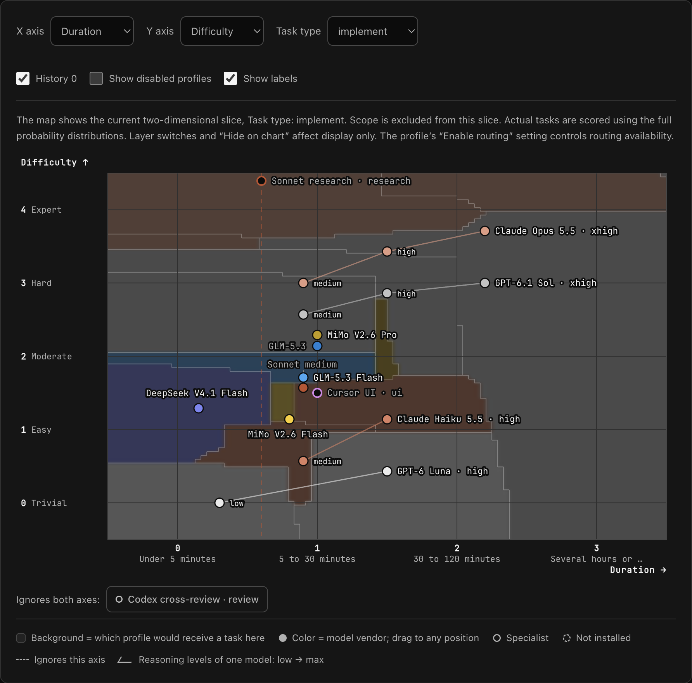

# herdr-router

herdr-router decides which coding agent, model, and reasoning effort should
handle a task, then starts that agent in a new [Herdr](https://herdr.dev) pane
and sends it the task.

If you run several coding agents, picking one for every task by hand gets
tedious, and the defaults are often wrong in both directions: a strong model at
high effort spends quota on a one-line rename, and a small model fails at a
design problem. herdr-router makes that choice from a policy you can see and
edit, and explains each decision.

https://github.com/user-attachments/assets/a3fac404-4d1f-4d71-b9cc-b34376324952

*16-second demo ([MP4](docs/media/herdr-router-demo.mp4)): Ctrl+B, then d opens
the router. Enter a task, see the recommended agent, model and effort, then
press Enter to start Codex in a new pane. The interface is in English; typing
and waiting are sped up, with the popup's local path hidden.*



*The routing map in the web editor. Each dot is a profile; the shading shows
which profile a task at that difficulty and duration would go to.*

## How it works

1. **Assess the task.** The task text is scored on a set of dimensions:
   difficulty, duration, scope, and task type by default. This uses the free
   `jev-1.13-free` model on OpenCode Zen (no API key), with English and Chinese
   keyword rules as an offline fallback.
2. **Pick a profile.** A profile is an agent, model, and effort with a position
   on those dimensions, for example Codex with GPT-6.1 Sol at medium effort.
   Each profile gets a penalty for being too weak, being more than the task
   needs, mismatching the task type, and its price and time per task. The
   lowest penalty wins.
3. **Dispatch in Herdr.** The router splits the current pane, starts the chosen
   agent with the right model and effort flags, sends the task, and waits until
   Herdr sees the agent working or blocked.

## Features

- **Routing is data, not code.** Dimensions, profiles, weights, and aliases live
  in one JSON policy. Adding a dimension needs no code change.
- **Territory map with draggable profiles.** The editor shades the plane by the
  winning profile, computed by the same scoring code the CLI uses. Drag a dot
  and the map updates.
- **Decisions you can inspect.** `route --json` shows the full ranking and each
  profile's penalty breakdown. The editor's trial run does the same against
  unsaved changes, without starting anything.
- **Several agent CLIs.** Claude Code, Codex, Cursor, Kimi, OpenCode, and Droid,
  each with its own model and effort flags. The same model can be switched
  between agents that can run it.
- **Your call wins.** `@opus` or `@<profile-id>` in the task pins a profile,
  `!hard` or `!duration=3` pins a dimension, and `--profile`, `--kind`,
  `--model`, `--effort` do the same from the command line.
- **Careful delivery.** Each dispatch reports whether the task was `not_sent`,
  `unknown`, or `confirmed`, and the router never resends a prompt on its own.
- **Sessions, handoff, and worktrees.** Dispatches are recorded in a local
  SQLite database. A follow-up task can continue a session in a new pane with a
  handoff file, and `--isolation worktree` runs a task on its own Git branch and
  working tree.
- **Small footprint.** Python standard library only, no frontend build. The
  terminal output and the local editor are available in English or Chinese.
  The editor needs a token and cannot dispatch agents.

The bundled policy is derived from [Artificial Analysis](https://artificialanalysis.ai/)
benchmark, price, and time data; the [guide](docs/guide.md#the-default-policy)
explains how.

## Requirements

- macOS or Linux, with Python 3.11 or newer available as `python3`.
- [Herdr](https://herdr.dev), tested with 0.9.3. Dispatching only works from
  inside a Herdr pane.
- At least one agent CLI used by the enabled profiles, such as Codex, Claude
  Code, or OpenCode, installed and signed in. The router only checks that the
  binary is on `PATH`; model access depends on that CLI's account.

## Install

```bash
git clone https://github.com/Qingswe/herdr-router.git
cd herdr-router
router_checkout="$PWD"
mkdir -p ~/.local/bin
ln -s "$router_checkout/bin/herdr-router" ~/.local/bin/herdr-router
export PATH="$HOME/.local/bin:$PATH"
herdr plugin link "$router_checkout"
herdr-router --version
```

The CLI symlink and the Herdr plugin both run files from this checkout, so keep
it where it is. Add `~/.local/bin` to `PATH` in your shell startup file. If
`~/.local/bin/herdr-router` already exists, check what it points to before
replacing it.

Optional Claude Code skill, so Claude Code can hand tasks off through the router:

```bash
mkdir -p ~/.claude/skills
ln -s "$router_checkout/skill" ~/.claude/skills/herdr-route
```

## Usage

Check where a task would go. This launches nothing and needs no network:

```bash
herdr-router route "rename one variable" --no-systemone
```

It prints the estimate for each dimension, the chosen profile, and the top
three with their penalties. Terminal output is in Chinese by default. For
English, add `"terminal_language": "en"` to your policy (it also applies to
the popup), or set `HERDR_ROUTER_LANGUAGE=en` for a single command.

From inside a Herdr pane, dispatch it for real:

```bash
herdr-router dispatch "fix the intermittent crash on login"
herdr-router dispatch "@opus review the session schema"    # pin a profile by alias
herdr-router dispatch "..." --dry-run                      # decide and validate only
```

If a dispatch fails, read `prompt_status` before retrying: `unknown` or
`confirmed` means the task may already have arrived, so look at the pane instead
of sending it again. See [Dispatch and recovery](docs/guide.md#dispatch-and-recovery).

Open the web editor:

```bash
herdr-router ui --open     # 127.0.0.1:8765, opens the browser
herdr-router ui --stop     # stop an editor the plugin started in the background
```

Saving writes `~/.config/herdr/plugins/config/herdr-router/policy.json` and
keeps the last 10 versions.

## Herdr shortcuts

After linking the plugin, add these bindings to `~/.config/herdr/config.toml`
(choose other keys if these are already in use):

```toml
[[keys.command]]
key = "prefix+d"
type = "plugin_action"
command = "herdr-router.route"

[[keys.command]]
key = "prefix+ctrl+d"
type = "plugin_action"
command = "herdr-router.route-selection"

[[keys.command]]
key = "prefix+shift+e"
type = "plugin_action"
command = "herdr-router.open-editor"
```

Run `herdr server reload-config` to apply them. `prefix` means your configured
Herdr prefix key: press it first, then the key below. Linking the plugin alone
does not install these bindings.

| After the prefix | Action |
|---|---|
| `d` | Open the router popup for the focused pane |
| `Ctrl+d` | Open the popup with selected terminal text as the task |
| `Shift+e` | Open the local web editor |

In the popup, enter a task and press Enter to see the recommendation. Press
Enter again to dispatch it in a new pane. To adjust it, type `k` (profile),
`m` (model), `e` (effort), or `t` (task), then press Enter; type `q` and press
Enter to cancel. The [guide](docs/guide.md#herdr-plugin-actions) has more details.

## More

The [user guide](docs/guide.md) covers the scoring formula, the default policy,
the policy file, sessions and handoff, worktree isolation, the editor tabs, file
locations, and troubleshooting.

Run the tests with:

```bash
python3 -m unittest discover -s tests -t .
node tests/test_frontend.js      # needs Node.js
```
