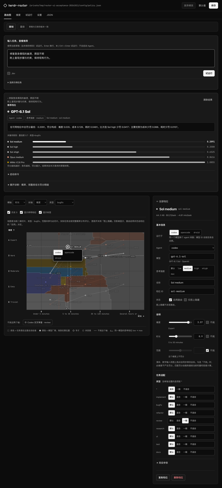
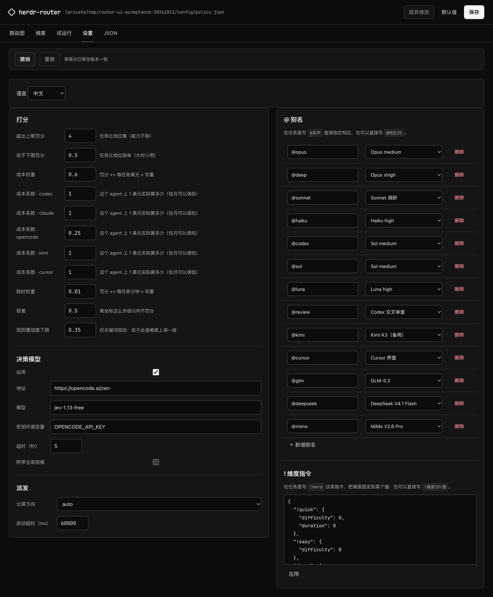

# herdr-router

herdr-router chooses a coding agent, model, and reasoning effort for a task,
then starts that agent in a new [Herdr](https://herdr.dev) pane and sends it
the task.

It estimates how hard and how long the task is, and what kind of work it is,
then picks the closest match from a list of profiles such as "Codex with
GPT-6.1 Sol at medium effort" or "Claude Code with Opus at xhigh". The profiles
live in a JSON policy that you edit in a local web editor.

<table>
  <tr>
    <td width="50%" valign="top">
      <a href="plans/ui-refresh-evidence/desktop-chart-editor.png"></a>
    </td>
    <td width="50%" valign="top">
      <a href="plans/ui-refresh-evidence/desktop-settings.png"></a>
    </td>
  </tr>
  <tr>
    <td valign="top">Routing map and profile editor. Drag a profile to change which tasks it gets.</td>
    <td valign="top">Settings: penalties, costs, the assessment backend, and aliases.</td>
  </tr>
</table>

The screenshots use the Chinese interface; the editor also has English. Click
an image for full size.

## Requirements

- macOS or Linux, with Python 3.11 or newer available as `python3`. No Python
  packages or build step are needed.
- [Herdr](https://herdr.dev), tested with 0.9.3. Dispatching only works from
  inside a Herdr pane.
- At least one agent CLI used by the enabled profiles, such as Codex, Claude
  Code, or OpenCode, installed and signed in. The router only checks that the
  binary is on `PATH`; model access depends on that CLI's account.

Tasks are assessed by the free `jev-1.13-free` model on OpenCode Zen, which
needs no API key. If that call fails, keyword rules (English and Chinese) are
used instead.

## Install

```bash
git clone https://github.com/Qingswe/herdr-router.git
cd herdr-router
router_checkout="$PWD"
mkdir -p ~/.local/bin
ln -s "$router_checkout/bin/herdr-router" ~/.local/bin/herdr-router
export PATH="$HOME/.local/bin:$PATH"
herdr plugin link "$router_checkout"
herdr-router --version
```

The CLI symlink and the Herdr plugin both run files from this checkout, so keep
it where it is. Add `~/.local/bin` to `PATH` in your shell startup file. If
`~/.local/bin/herdr-router` already exists, check what it points to before
replacing it.

Optional Claude Code skill, so Claude Code can hand tasks off through the router:

```bash
mkdir -p ~/.claude/skills
ln -s "$router_checkout/skill" ~/.claude/skills/herdr-route
```

## Usage

Check where a task would go. This launches nothing and needs no network:

```bash
herdr-router route "rename one variable" --no-systemone
```

It prints the estimate for each dimension, the chosen profile, and the top
three with their penalties. Terminal labels are currently in Chinese.

From inside a Herdr pane, dispatch it for real:

```bash
herdr-router dispatch "fix the intermittent crash on login"
herdr-router dispatch "@opus review the session schema"    # pin a profile by alias
herdr-router dispatch "..." --dry-run                      # decide and validate only
```

The router splits the current pane, starts the agent, sends the task, and waits
until Herdr reports the agent as working or blocked. If a dispatch fails, read
`prompt_status` before retrying: `unknown` or `confirmed` means the task may
already have arrived, so look at the pane instead of sending it again. See
[Dispatch and recovery](docs/guide.md#dispatch-and-recovery).

Open the web editor:

```bash
herdr-router ui --open     # 127.0.0.1:8765, opens the browser
herdr-router ui --stop     # stop an editor the plugin started in the background
```

Saving writes `~/.config/herdr/plugins/config/herdr-router/policy.json` and
keeps the last 10 versions. The editor can change launch settings but cannot
start agents.

Linking the plugin also adds Herdr actions for a routing popup, routing the
selected text, and opening the editor. The [guide](docs/guide.md#herdr-plugin-actions)
has a keybinding example.

## More

The [user guide](docs/guide.md) covers how scoring works, how the default policy
was derived from Artificial Analysis data, the policy file, sessions and
handoff, worktree isolation, editor details, file locations, and
troubleshooting.

Run the tests with:

```bash
python3 -m unittest discover -s tests -t .
node tests/test_frontend.js      # needs Node.js
```
